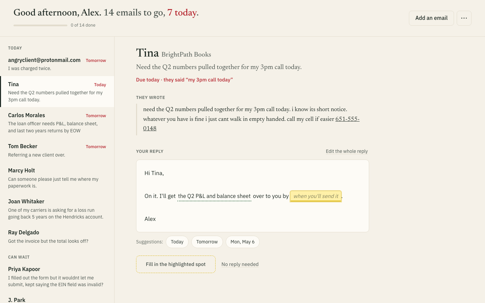

# Inbox Desk

**The morning inbox for a small bookkeeping firm, triaged before the owner's coffee is done.**

Takes a pile of messy client emails plus a messy CRM export and produces:

- a **priority queue** of every email, with an explainable score ("critical +70, due tomorrow +15, angry +10")
- a **reply draft** for each, in the owner's voice, with `[[blanks]]` highlighted wherever the draft would otherwise have to make up a fact
- **guardrails** enforced in code: no refund promises, no dollar amounts that aren't in a source, EINs and SSNs masked, billing disputes always routed to the owner
- **CRM reconciliation**: each email matched to a client record (by sender, domain, phone or email in the body), proposed field updates, and a list of records with gaps
- a **per-client action list**, plus exports: `brief.md`, `crm_proposed_changes.csv`, `drafts.md`, and an **updated CRM CSV** with your accepted changes applied

Vertical: **independent accounting and bookkeeping firms** (Track A). Built against the provided sample data.



## Run it (2 minutes)

Requires Node 20+.

```bash
npm install
cp .env.example .env          # paste your ANTHROPIC_API_KEY (optional, see below)
npm run triage                # CLI: triage the inbox, print the queue, write out/
npm start                     # dashboard at http://localhost:3000
```

**No API key?** It still runs. Without a key it uses the offline rules engine (same output shape, template drafts) and says so in the header. With a key it uses Claude Haiku 4.5.

### The morning, in practice

One email at a time: **read it, fill in the yellow spots, press Send.**

1. Open http://localhost:3000. On the left, emails are split into **Today** and **Can wait**. Each row shows a name, what they want, and when it's due. The most urgent email is already open.
2. You see what they wrote, then your reply. Anything the draft couldn't know (a date, an amount, a yes/no only you can answer) is a **yellow spot inside the reply text**, and the cursor is already in the first one. Type, or click a suggestion under the reply, and you move to the next spot. Suggestions come from the client's own deadline, the email itself and your firm profile.
3. **Send reply** (or ⌘↵) opens your email app with the reply filled in and addressed, then moves you to the next email. **Undo** is in the notification. **No reply needed** closes an email without replying.
4. With an API key there's one more box under the reply: "Want it different? Tell Claude", for things like "make it shorter" or "tell her Monday".
5. When you're done, it offers **Update my CRM**: the changes your emails mentioned, all ticked. Untick anything that's wrong and download your updated CRM file.

Everything else (re-checking emails, the day's summary) lives in the **⋯** menu.

Things to look at in the demo:
- **Ray Delgado (invoice #4471):** "Your call". The draft never says which amount is right.
- **Priya Kapoor:** her EIN is kept out of the reply and the CRM notes.
- **Tom Becker:** the email came from Sandra Liu, the referrer. It was matched to Tom's record by the phone number in the body, and his missing email address shows up in the CRM step.
- **Add an email:** paste any email from your mail app and get a draft back.

### Other commands

```bash
npm run triage -- --offline                 # force the rules engine
npm run triage -- --emails DIR --crm FILE   # your own data
npm run triage -- --as-of 2024-05-02        # the "today" relative dates resolve against
npm run eval                                # score against hand labels (sample set)
npm run eval -- --holdout                   # score on 8 held-out emails
npm test                                    # 13 unit tests: normalizers, matching, guardrails
```

`TRIAGE_MODEL=claude-sonnet-5-5 npm run triage` swaps the model if you want to compare.

## How it works

```
emails/*.txt ─┐
              ├─► ingest + normalize ─► CRM match (deterministic) ─► Claude: 1 call/email ─► guardrails (code) ─► queue + exports
crm.csv ──────┘   6 date formats,       sender → domain →            structured output,     mask PII, block money
                  phones, statuses       body email/phone → name      schema-validated       promises, check amounts,
                                                                                             priority score
```

Each layer does the part it's suited for:

| Layer | Does | Why there |
|---|---|---|
| `ingest.js`, `normalize.js` | Parse headers, CSV, 6 date formats, phones, `name at domain dot com` | Deterministic, testable, free |
| `match.js` | Decide which client an email is about | A wrong match sends a reply into the wrong client's file. Code decides, with a confidence score; the model is told the answer, not asked |
| `llm.js` | Intent, urgency, deadline resolution ("by friday" → 2024-05-03), action items, questions asked, CRM suggestions, the draft | Needs language judgment |
| `guardrails.js` | Mask EIN/SSN, block refund promises, flag amounts not in any source, force owner review on disputes, priority score | The model is told these rules too. This is the check that still holds when it doesn't follow them |
| `offline.js` | Keyword rules with the same output shape | Runs with no key, and serves as the baseline the eval compares against |

**Cost:** one Haiku 4.5 call per email. Estimated at about 2.5K tokens in (prompt, schema, CRM record, email) and about 700 out, which comes to roughly **$0.006 per email, under 10 cents for this inbox**. That's an estimate. The CLI and dashboard both print the actual tokens and dollars for each run.

## Eval

Hand labels for all 14 sample emails (`eval/gold.json`) plus **8 held-out emails** (`eval/holdout/`) written and labeled *before* any engine ran on them: a colleague writing from a shared company domain, a client on a new email address, a QuickBooks system notification, a reply that changes a deadline, a CPA-letter request the firm can't fulfill, and similar cases.

| | Offline rules, sample | Offline rules, **holdout** |
|---|---|---|
| Client match (code) | 100% | **100%** |
| Intent | 100% | **50%** |
| Urgency | 100% | **50%** |
| Deadline | 100% | **63%** |
| Owner review on money disputes | 100% | **0%** |

To score Claude on the same sets, put a key in `.env` and run `npm run eval` and `npm run eval -- --holdout`. That's 22 calls, about 10 cents. Without a key, the Claude path was checked three ways:
- the schema compiles to a strict JSON schema
- a real request reaches the API and fails cleanly on auth
- the rewrite flow passes a browser test with the API mocked

The rules score 100% on the sample set because I wrote them while reading those emails. On emails they haven't seen they fall to a coin flip. That gap is why the model is there. The deterministic matching generalizes fine, which is why it stays in code.

## Layout

```
src/        ingest, normalize, match, llm, guardrails, offline, pipeline, export, cli, server, eval
public/     dashboard (vanilla HTML/CSS/JS, no build step)
eval/       gold labels + held-out emails
test/       node:test unit tests
firm.json   the firm profile drafts are grounded in (services, payment methods, policies)
docs/       write-up, AI workflow log, Loom script
```
